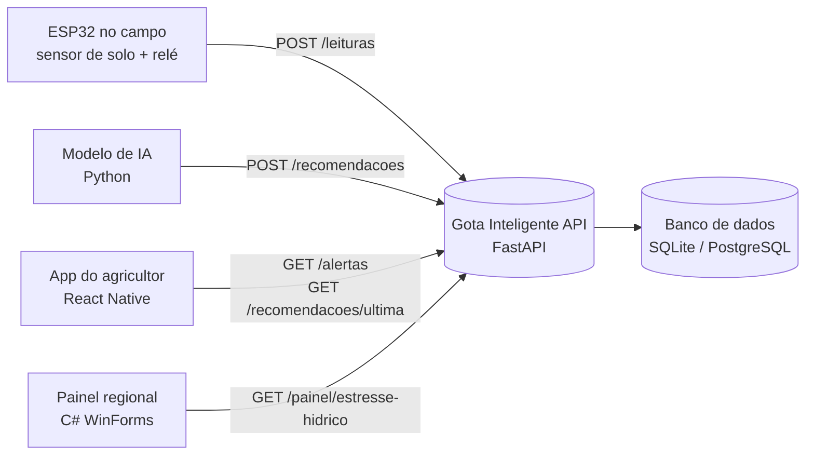
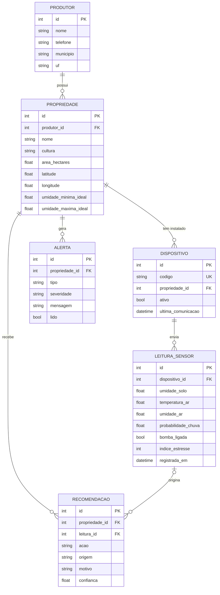
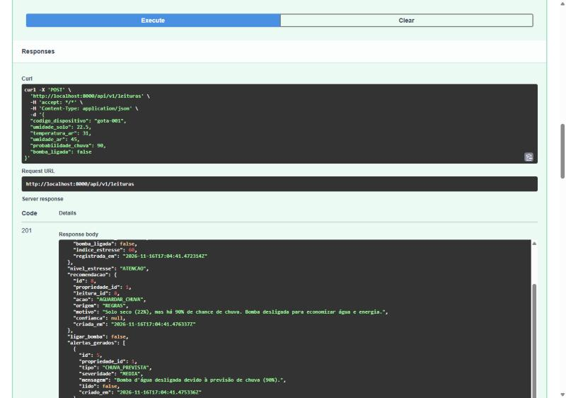

# 💧 Gota Inteligente — API (SOA e Web Services)

Backend da **Gota Inteligente**, a CitizenTech da equipe na Global Solution 2026.2 (FIAP · Engenharia de Software · 3º ano).

A API recebe as leituras do kit ESP32 instalado na roça (umidade do solo, temperatura, umidade do ar), cruza com a previsão de chuva, **decide se a bomba d'água deve ser ligada** e gera alertas para o app do agricultor e para o painel regional do Sindicato Rural / Prefeitura.

---

## 📋 Ficha da CitizenTech

| | |
|---|---|
| **Nome** | Gota Inteligente |
| **Território** | Cinturão verde de São Paulo (ex.: Ibiúna, Piedade, Mogi das Cruzes) |
| **Cidadão beneficiado** | O agricultor familiar |
| **Problema, em uma frase** | O pequeno produtor desperdiça água e energia regando "no olhômetro", ou perde a plantação numa seca repentina. |
| **Como funciona** | Um sensor de solo de baixo custo (ESP32) envia leituras para esta API, que cruza o solo com a previsão do tempo e recomenda irrigar, não irrigar ou aguardar a chuva. |
| **O que cada parte faz** | **IoT (ESP32/Wokwi):** mede o solo e liga/desliga a bomba · **SOA (esta API):** recebe dados, decide, guarda histórico e alerta · **IA/ML (Python):** modelo que refina a decisão e envia para a API · **Mobile (React Native):** app do agricultor com os alertas · **C# (WinForms):** painel regional de estresse hídrico |
| **Indicador de impacto** | Irrigações evitadas e litros de água economizados (calculados pela API no endpoint do painel) |
| **ODS conectados** | **ODS 2** (Fome zero e agricultura sustentável): ajuda o pequeno produtor a não perder a safra na seca · **ODS 6** (Água potável e saneamento): reduz o desperdício de água na irrigação · **ODS 13** (Ação contra a mudança do clima): usa a previsão do tempo para adaptar a irrigação a eventos extremos e economiza energia da bomba |

## 👥 Integrantes

| Nome | RM |
|---|---|
| Henrique Maciel Rodrigues | RM559628 |
| Igor Pereira Nociti | RM560225 |
| João Pedro Vieira de Moais | RM560527 |
| Luigi Bonuccelli | RM560950 |
| Pedro Paulo Sabino Botelho | RM559578 |

---

## 🧱 Arquitetura



A API é organizada em camadas, cada uma com uma responsabilidade:

```
app/
├── core/          # configuração, conexão com o banco e tratamento de erros
├── domain/        # o coração do negócio
│   ├── models.py  #   entidades (tabelas) e seus relacionamentos
│   ├── enums.py   #   ações, origens, tipos de alerta, severidades
│   └── regras.py  #   regras de irrigação e índice de estresse hídrico (funções puras)
├── schemas/       # contratos de entrada/saída da API (validação com Pydantic)
├── services/      # casos de uso (cadastros, telemetria, painel)
└── api/routes/    # endpoints REST (controllers)
alembic/versions/  # migrações do banco de dados
scripts/seed.py    # dados simulados para demonstração
tests/             # testes automatizados (pytest)
insomnia/          # coleção de testes manuais do Insomnia
docs/evidencias/   # evidências da execução dos testes
```

**Tecnologias:** Python 3.11+, FastAPI, SQLAlchemy 2.0 (ORM), Alembic (migrações), Pydantic v2 (validação), SQLite (padrão) ou PostgreSQL, Pytest, Insomnia.

## 🗃️ Modelo de dados



O banco também tem regras próprias (constraints): área sempre positiva, umidade mínima menor que a máxima, umidade e chance de chuva entre 0 e 100, código do dispositivo único e chaves estrangeiras com exclusão em cascata.

## 🧠 Regras de negócio (`app/domain/regras.py`)

**Decisão de irrigação**, cruzando o solo com a previsão:

| Situação | Decisão |
|---|---|
| Solo acima da umidade máxima ideal da cultura | `NAO_IRRIGAR` |
| Solo seco **e** chance de chuva ≥ 70% | `AGUARDAR_CHUVA`: bomba desligada para economizar água e energia |
| Solo seco abaixo de 15% (crítico), mesmo com chuva prevista | `IRRIGAR`: para não perder a plantação |
| Solo seco e pouca chance de chuva | `IRRIGAR` |
| Solo na faixa ideal, mas perto do mínimo, com calor ≥ 32 °C e ar seco < 40% | `IRRIGAR` (preventiva) |
| Solo na faixa ideal | `NAO_IRRIGAR` |

**Índice de estresse hídrico (0 a 100):** 70% falta de água no solo + 20% calor + 10% ar seco. Fica `NORMAL` abaixo de 40, `ATENCAO` de 40 a 69 e `CRITICO` a partir de 70.

**Água economizada:** cada `AGUARDAR_CHUVA` conta como uma irrigação evitada. Com lâmina de 5 mm, isso dá 50.000 L por hectare.

**Alertas automáticos:** estresse crítico (severidade ALTA), bomba desligada por previsão de chuva (MEDIA) e solo encharcado ≥ 90% (BAIXA).

## 🔌 Endpoints

Documentação interativa (Swagger) em **http://localhost:8000/docs** com a API rodando.

| Método | Rota | Quem usa | Descrição |
|---|---|---|---|
| GET | `/health` | todos | Status da API |
| GET, POST | `/api/v1/produtores` | cadastro | Lista (filtro por município, paginação) e cadastra |
| GET, PUT, DELETE | `/api/v1/produtores/{id}` | cadastro | Busca, atualiza e remove |
| GET, POST | `/api/v1/propriedades` | cadastro | Lista (filtros) e cadastra |
| GET, PUT, DELETE | `/api/v1/propriedades/{id}` | cadastro | Busca, atualiza e remove |
| GET, POST | `/api/v1/dispositivos` | cadastro | Lista e cadastra kits ESP32 |
| GET, PATCH, DELETE | `/api/v1/dispositivos/{id}` | cadastro | Busca, ativa/desativa e remove |
| **POST** | `/api/v1/leituras` | **ESP32** | Envia leitura e recebe a decisão (`ligar_bomba`) |
| GET | `/api/v1/leituras` | todos | Histórico (por dispositivo ou propriedade) |
| **POST** | `/api/v1/recomendacoes` | **IA (Python)** | Registra a decisão do modelo de ML |
| GET | `/api/v1/recomendacoes` | todos | Histórico de recomendações |
| GET | `/api/v1/recomendacoes/ultima/{propriedade_id}` | **App / ESP32** | Última decisão da propriedade |
| GET | `/api/v1/alertas` | **App** | Alertas (filtros: propriedade, lido, severidade) |
| PATCH | `/api/v1/alertas/{id}/lido` | **App** | Marca como lido |
| GET | `/api/v1/painel/estresse-hidrico` | **Painel C#** | Situação de cada propriedade + resumo regional |

Exemplo: o ESP32 envia uma leitura

```http
POST /api/v1/leituras
Content-Type: application/json

{ "codigo_dispositivo": "gota-001", "umidade_solo": 20, "temperatura_ar": 31,
  "umidade_ar": 40, "probabilidade_chuva": 90 }
```

e recebe (resumido):

```json
{
  "nivel_estresse": "ATENCAO",
  "ligar_bomba": false,
  "recomendacao": { "acao": "AGUARDAR_CHUVA",
    "motivo": "Solo seco (20%), mas há 90% de chance de chuva. Bomba desligada para economizar água e energia." },
  "alertas_gerados": [ { "tipo": "CHUVA_PREVISTA",
    "mensagem": "Bomba d'água desligada devido à previsão de chuva (90%)." } ]
}
```

Os erros seguem um formato padrão: `404` para recurso inexistente, `409` para código de dispositivo duplicado e `422` para dados inválidos ou regra de negócio violada.

---

## ▶️ Como executar

**Pré-requisito:** Python 3.11 ou mais novo.

**Atalho no Windows:** dê dois cliques em `iniciar_api.bat`. Ele cria o ambiente, instala as dependências, aplica as migrações, popula os dados simulados e sobe a API.

Ou, passo a passo:

```powershell
# 1. Entrar na pasta e criar o ambiente virtual
cd gota-inteligente-soa
python -m venv .venv
.\.venv\Scripts\Activate.ps1          # Windows (PowerShell)
# source .venv/bin/activate           # macOS / Linux

# 2. Instalar as dependências
pip install -r requirements.txt

# 3. Criar o banco aplicando as migrações
alembic upgrade head

# 4. (Opcional) Popular com dados simulados
python -m scripts.seed

# 5. Subir a API
uvicorn app.main:app --reload
```

A API fica em **http://localhost:8000**, com o Swagger em **http://localhost:8000/docs**.

### Banco de dados

Por padrão a API usa **SQLite** (arquivo `gota_inteligente.db`), sem precisar instalar nada. Para usar PostgreSQL, copie `.env.example` para `.env`, ajuste a `DATABASE_URL` e instale o driver (`pip install "psycopg[binary]"`).

### Migrações (Alembic)

| Versão | O que faz |
|---|---|
| `0001_cadastros_e_telemetria` | Cria `produtores`, `propriedades`, `dispositivos` e `leituras_sensor`, com chaves, índices e constraints |
| `0002_recomendacoes_e_alertas` | Cria `recomendacoes` e `alertas` |
| `0003_indice_estresse_hidrico` | Evolução do modelo: adiciona `indice_estresse` em `leituras_sensor` |

```powershell
alembic upgrade head      # aplica todas
alembic downgrade -1      # desfaz a última
alembic history           # lista as versões
alembic current           # mostra a versão atual do banco
```

---

## 🧪 Testes

### Testes manuais (Insomnia)

1. Suba a API num banco novo: `alembic upgrade head`, depois `python -m scripts.seed` e `uvicorn app.main:app`.
2. No Insomnia: **Import → From File →** `insomnia/gota-inteligente-insomnia.json`.
3. Selecione o ambiente **Local** (`base_url = http://localhost:8000`).
4. Execute as requisições **na ordem das pastas** (0 → 8). A descrição de cada uma diz o status esperado.

A coleção tem **33 requisições** que cobrem os CRUDs, os quatro cenários de decisão de irrigação, a integração com a IA, os alertas, o painel e os casos de erro (404/409/422).

📄 As evidências estão em [`docs/evidencias/testes-manuais.md`](docs/evidencias/testes-manuais.md): prints da API rodando no Windows (Swagger, leitura do ESP32, painel e tratamento de erro) e o resultado de cada requisição da coleção (**33/33 com o status esperado**).



### Testes automatizados

```powershell
pytest -q
```

São 17 testes: regras de irrigação, CRUD, validações, conflitos, telemetria e painel. Cada teste cria um banco temporário **aplicando as migrações**.

---

## 🔒 Segurança e dados

- Todo acesso ao banco passa pelo ORM (SQLAlchemy) com parâmetros vinculados, o que protege contra **SQL Injection**.
- Toda entrada é validada (tipos, faixas e formatos) antes de chegar ao banco.
- **Nenhum dado pessoal real:** todos os produtores e propriedades do seed são **simulados**.

## 🤖 Uso de IA

Conforme as regras da GS, os prompts usados estão registrados em [`prompts.md`](prompts.md).
