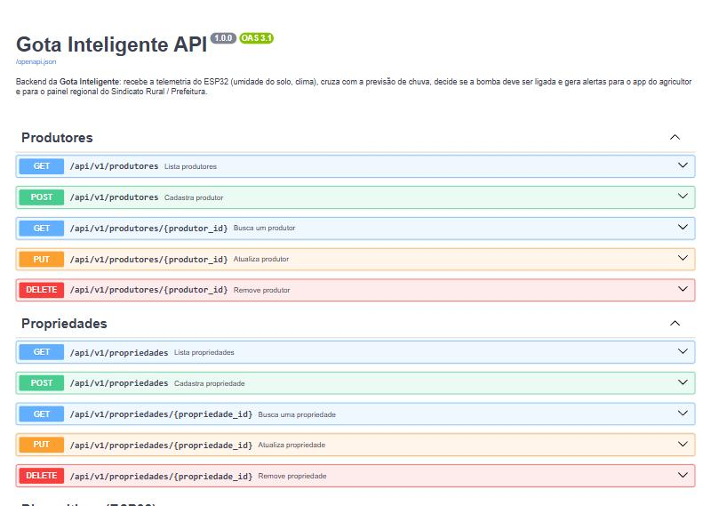
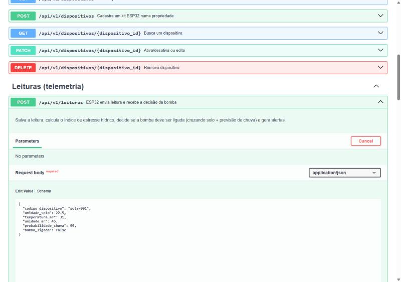
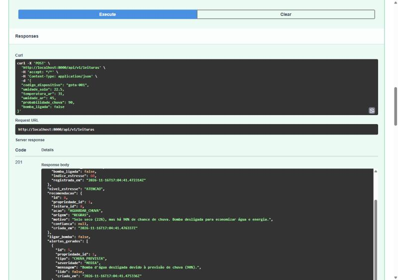
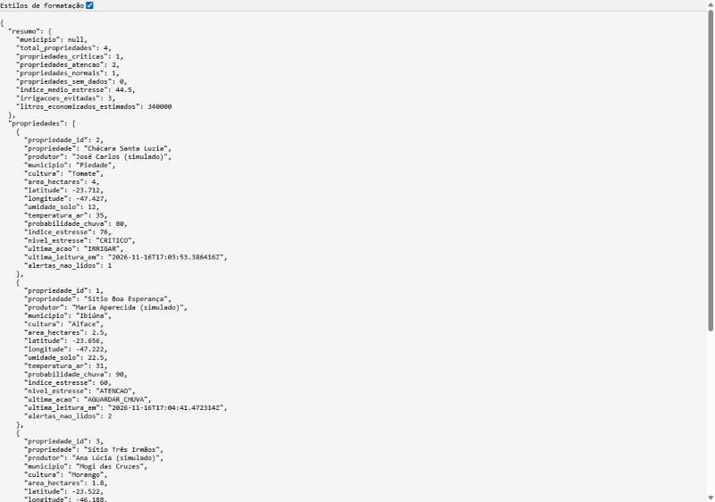
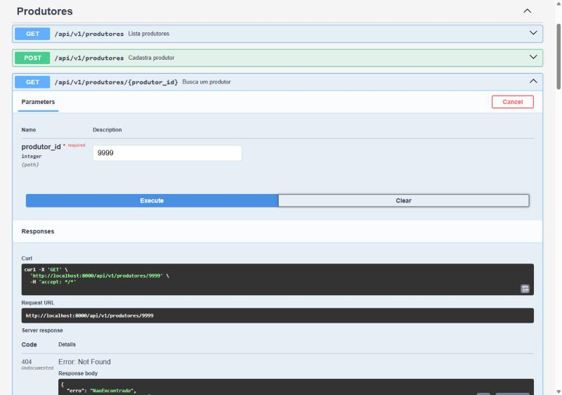

# Evidências dos testes manuais

## Prints da API rodando (Windows, máquina da equipe)

API iniciada com `iniciar_api.bat`: migrações aplicadas, seed carregado e servidor no ar em `http://localhost:8000`.

| | |
|---|---|
| **1. Swagger com todos os endpoints** |  |
| **2. ESP32 envia leitura: solo seco (22,5%) + 90% de chance de chuva** |  |
| **3. Resposta 201: decisão `AGUARDAR_CHUVA`, `ligar_bomba: false` e alerta `CHUVA_PREVISTA`** |  |
| **4. Painel regional (consumido pelo C# WinForms): resumo e propriedades da mais crítica para a menos crítica** |  |
| **5. Tratamento de erro: produtor inexistente retorna 404 com mensagem padronizada** |  |

---

## Execução da coleção do Insomnia

Execução da coleção `insomnia/gota-inteligente-insomnia.json`, na ordem, contra a API rodando localmente
com o banco criado pelas migrações (`alembic upgrade head`) e populado pelo seed (`python -m scripts.seed`).

Data da execução: 16/11/2026 13:47

| # | Pasta | Requisição | Esperado | Obtido | OK |
|---|---|---|---|---|---|
| 1 | 0. Status | GET `/health` — Health check | 200 | 200 | ✅ |
| 2 | 1. Produtores | GET `/api/v1/produtores` — Listar produtores | 200 | 200 | ✅ |
| 3 | 1. Produtores | GET `/api/v1/produtores?municipio=Ibiúna` — Filtrar por município | 200 | 200 | ✅ |
| 4 | 1. Produtores | POST `/api/v1/produtores` — Cadastrar produtor | 201 | 201 | ✅ |
| 5 | 1. Produtores | GET `/api/v1/produtores/4` — Buscar produtor por id | 200 | 200 | ✅ |
| 6 | 1. Produtores | PUT `/api/v1/produtores/4` — Atualizar produtor | 200 | 200 | ✅ |
| 7 | 1. Produtores | POST `/api/v1/produtores` — ERRO - dados inválidos (422) | 422 | 422 | ✅ |
| 8 | 1. Produtores | GET `/api/v1/produtores/9999` — ERRO - produtor inexistente (404) | 404 | 404 | ✅ |
| 9 | 2. Propriedades | GET `/api/v1/propriedades` — Listar propriedades | 200 | 200 | ✅ |
| 10 | 2. Propriedades | POST `/api/v1/propriedades` — Cadastrar propriedade | 201 | 201 | ✅ |
| 11 | 2. Propriedades | PUT `/api/v1/propriedades/5` — Atualizar propriedade | 200 | 200 | ✅ |
| 12 | 2. Propriedades | PUT `/api/v1/propriedades/5` — ERRO - faixa de umidade inválida (422) | 422 | 422 | ✅ |
| 13 | 3. Dispositivos (ESP32) | POST `/api/v1/dispositivos` — Cadastrar dispositivo | 201 | 201 | ✅ |
| 14 | 3. Dispositivos (ESP32) | POST `/api/v1/dispositivos` — ERRO - código duplicado (409) | 409 | 409 | ✅ |
| 15 | 3. Dispositivos (ESP32) | GET `/api/v1/dispositivos?propriedade_id=5` — Listar dispositivos da propriedade | 200 | 200 | ✅ |
| 16 | 4. Leituras (telemetria do ESP32) | POST `/api/v1/leituras` — Solo seco + 90% de chuva = AGUARDAR_CHUVA | 201 | 201 | ✅ |
| 17 | 4. Leituras (telemetria do ESP32) | POST `/api/v1/leituras` — Solo seco + sem chuva = IRRIGAR | 201 | 201 | ✅ |
| 18 | 4. Leituras (telemetria do ESP32) | POST `/api/v1/leituras` — Solo crítico = IRRIGAR mesmo com chuva | 201 | 201 | ✅ |
| 19 | 4. Leituras (telemetria do ESP32) | POST `/api/v1/leituras` — Solo úmido = NAO_IRRIGAR | 201 | 201 | ✅ |
| 20 | 4. Leituras (telemetria do ESP32) | POST `/api/v1/leituras` — ERRO - dispositivo não cadastrado (404) | 404 | 404 | ✅ |
| 21 | 4. Leituras (telemetria do ESP32) | POST `/api/v1/leituras` — ERRO - umidade acima de 100% (422) | 422 | 422 | ✅ |
| 22 | 4. Leituras (telemetria do ESP32) | GET `/api/v1/leituras?propriedade_id=5&limite=10` — Histórico de leituras da propriedade | 200 | 200 | ✅ |
| 23 | 5. Recomendações | POST `/api/v1/recomendacoes` — Registrar decisão da IA (Python) | 201 | 201 | ✅ |
| 24 | 5. Recomendações | GET `/api/v1/recomendacoes/ultima/5` — Última recomendação da propriedade | 200 | 200 | ✅ |
| 25 | 5. Recomendações | GET `/api/v1/recomendacoes?propriedade_id=5` — Histórico de recomendações | 200 | 200 | ✅ |
| 26 | 6. Alertas (app do agricultor) | GET `/api/v1/alertas?propriedade_id=5&lido=false` — Alertas não lidos da propriedade | 200 | 200 | ✅ |
| 27 | 6. Alertas (app do agricultor) | GET `/api/v1/alertas?severidade=ALTA` — Alertas de severidade ALTA | 200 | 200 | ✅ |
| 28 | 6. Alertas (app do agricultor) | PATCH `/api/v1/alertas/1/lido` — Marcar alerta como lido | 200 | 200 | ✅ |
| 29 | 7. Painel regional (C# WinForms) | GET `/api/v1/painel/estresse-hidrico` — Estresse hídrico - todas as propriedades | 200 | 200 | ✅ |
| 30 | 7. Painel regional (C# WinForms) | GET `/api/v1/painel/estresse-hidrico?municipio=Piedade` — Estresse hídrico - por município | 200 | 200 | ✅ |
| 31 | 8. Limpeza | DELETE `/api/v1/dispositivos/5` — Remover dispositivo | 204 | 204 | ✅ |
| 32 | 8. Limpeza | DELETE `/api/v1/propriedades/5` — Remover propriedade | 204 | 204 | ✅ |
| 33 | 8. Limpeza | DELETE `/api/v1/produtores/4` — Remover produtor | 204 | 204 | ✅ |

**Resultado: 33/33 requisições com o status esperado.**

---

## Detalhe de cada requisição

### 1. Health check
`GET /health` → **200**

Resposta:
```json
{
  "status": "ok",
  "servico": "Gota Inteligente API",
  "versao": "1.0.0"
}
```

### 2. Listar produtores
`GET /api/v1/produtores` → **200**

Resposta:
```json
[
  {
    "nome": "Maria Aparecida (simulado)",
    "telefone": "(15) 90000-0001",
    "municipio": "Ibiúna",
    "uf": "SP",
    "id": 1,
    "criado_em": "2026-11-16T16:47:34.088391Z"
  },
  {
    "nome": "José Carlos (simulado)",
    "telefone": "(15) 90000-0002",
    "municipio": "Piedade",
    "uf": "SP",
    "id": 2,
    "criado_em": "2026-11-16T16:47:34.092586Z"
  },
  {
    "nome": "Ana Lúcia (simulado)",
    "telefone": "(11) 90000-0003",
    "municipio": "Mogi das Cruzes",
    "uf": "SP",
    "id": 3,
    "criado_em": "2026-11-16T16:47:34.094454Z"
  }
]
```

### 3. Filtrar por município
`GET /api/v1/produtores?municipio=Ibiúna` → **200**

Resposta:
```json
[
  {
    "nome": "Maria Aparecida (simulado)",
    "telefone": "(15) 90000-0001",
    "municipio": "Ibiúna",
    "uf": "SP",
    "id": 1,
    "criado_em": "2026-11-16T16:47:34.088391Z"
  }
]
```

### 4. Cadastrar produtor
`POST /api/v1/produtores` → **201**

Corpo enviado:
```json
{
  "nome": "Carlos Henrique (simulado)",
  "telefone": "(15) 90000-0010",
  "municipio": "Piedade",
  "uf": "SP"
}
```
Resposta:
```json
{
  "nome": "Carlos Henrique (simulado)",
  "telefone": "(15) 90000-0010",
  "municipio": "Piedade",
  "uf": "SP",
  "id": 4,
  "criado_em": "2026-11-16T16:47:37.540832Z"
}
```

### 5. Buscar produtor por id
`GET /api/v1/produtores/4` → **200**

Resposta:
```json
{
  "nome": "Carlos Henrique (simulado)",
  "telefone": "(15) 90000-0010",
  "municipio": "Piedade",
  "uf": "SP",
  "id": 4,
  "criado_em": "2026-11-16T16:47:37.540832Z"
}
```

### 6. Atualizar produtor
`PUT /api/v1/produtores/4` → **200**

Corpo enviado:
```json
{
  "telefone": "(15) 90000-0099"
}
```
Resposta:
```json
{
  "nome": "Carlos Henrique (simulado)",
  "telefone": "(15) 90000-0099",
  "municipio": "Piedade",
  "uf": "SP",
  "id": 4,
  "criado_em": "2026-11-16T16:47:37.540832Z"
}
```

### 7. ERRO - dados inválidos (422)
`POST /api/v1/produtores` → **422**

Corpo enviado:
```json
{
  "nome": "Jo",
  "municipio": "X",
  "uf": "sp"
}
```
Resposta:
```json
{
  "detail": [
    {
      "type": "string_too_short",
      "loc": [
        "body",
        "nome"
      ],
      "msg": "String should have at least 3 characters",
      "input": "Jo",
      "ctx": {
        "min_length": 3
      }
    },
    {
      "type": "string_too_short",
      "loc": [
        "body",
        "municipio"
      ],
      "msg": "String should have at least 2 characters",
      "input": "X",
      "ctx": {
        "min_length": 2
      }
    },
    {
      "type": "string_pattern_mismatch",
      "loc": [
        "body",
        "uf"
      ],
      "msg": "String should match pattern '^[A-Z]{2}$'",
      "input": "sp",
      "ctx": {
        "pattern": "^[A-Z]{2}$"
      }
    }
  ]
}
```

### 8. ERRO - produtor inexistente (404)
`GET /api/v1/produtores/9999` → **404**

Resposta:
```json
{
  "erro": "NaoEncontrado",
  "mensagem": "Produtor 9999 não encontrado."
}
```

### 9. Listar propriedades
`GET /api/v1/propriedades` → **200**

Resposta:
```json
[
  {
    "nome": "Sítio Boa Esperança",
    "municipio": "Ibiúna",
    "latitude": -23.656,
    "longitude": -47.222,
    "area_hectares": 2.5,
    "cultura": "Alface",
    "umidade_minima_ideal": 40.0,
    "umidade_maxima_ideal": 75.0,
    "id": 1,
    "produtor_id": 1,
    "criado_em": "2026-11-16T16:47:34.096917Z"
  },
  {
    "nome": "Chácara Santa Luzia",
    "municipio": "Piedade",
    "latitude": -23.712,
    "longitude": -47.427,
    "area_hectares": 4.0,
    "cultura": "Tomate",
    "umidade_minima_ideal": 35.0,
    "umidade_maxima_ideal": 70.0,
    "id": 2,
    "produtor_id": 2,
    "criado_em": "2026-11-16T16:47:34.103599Z"
  },
  {
    "nome": "Sítio Três Irmãos",
    "municipio": "Mogi das Cruzes",
    "latitude": -23.522,
    "longitude": -46.188,
    "area_hectares": 1.8,
    "cultura": "Morango",
    "umidade_minima_ideal": 45.0,
    "umidade_maxima_ideal": 80.0,
    "id": 3,
    "produtor_id": 3,
    "criado_em": "2026-11-16T16:47:34.107576Z"
  },
  {
    "nome": "Sítio Água Limpa",
    "municipio": "Ibiúna",
    "latitude": -23.64,
    "longitude": -47.19,
  ... (resposta cortada)
```

### 10. Cadastrar propriedade
`POST /api/v1/propriedades` → **201**

Corpo enviado:
```json
{
  "produtor_id": 4,
  "nome": "Sítio Recanto Verde",
  "municipio": "Piedade",
  "latitude": -23.7,
  "longitude": -47.41,
  "area_hectares": 3.0,
  "cultura": "Pimentão",
  "umidade_minima_ideal": 35,
  "umidade_maxima_ideal": 70
}
```
Resposta:
```json
{
  "nome": "Sítio Recanto Verde",
  "municipio": "Piedade",
  "latitude": -23.7,
  "longitude": -47.41,
  "area_hectares": 3.0,
  "cultura": "Pimentão",
  "umidade_minima_ideal": 35.0,
  "umidade_maxima_ideal": 70.0,
  "id": 5,
  "produtor_id": 4,
  "criado_em": "2026-11-16T16:47:37.566282Z"
}
```

### 11. Atualizar propriedade
`PUT /api/v1/propriedades/5` → **200**

Corpo enviado:
```json
{
  "cultura": "Pimentão orgânico"
}
```
Resposta:
```json
{
  "nome": "Sítio Recanto Verde",
  "municipio": "Piedade",
  "latitude": -23.7,
  "longitude": -47.41,
  "area_hectares": 3.0,
  "cultura": "Pimentão orgânico",
  "umidade_minima_ideal": 35.0,
  "umidade_maxima_ideal": 70.0,
  "id": 5,
  "produtor_id": 4,
  "criado_em": "2026-11-16T16:47:37.566282Z"
}
```

### 12. ERRO - faixa de umidade inválida (422)
`PUT /api/v1/propriedades/5` → **422**

Corpo enviado:
```json
{
  "umidade_minima_ideal": 90
}
```
Resposta:
```json
{
  "erro": "RegraDeNegocio",
  "mensagem": "umidade_minima_ideal deve ser menor que umidade_maxima_ideal."
}
```

### 13. Cadastrar dispositivo
`POST /api/v1/dispositivos` → **201**

Corpo enviado:
```json
{
  "codigo": "gota-005",
  "propriedade_id": 5,
  "descricao": "Kit ESP32 - Sítio Recanto Verde"
}
```
Resposta:
```json
{
  "id": 5,
  "codigo": "gota-005",
  "propriedade_id": 5,
  "descricao": "Kit ESP32 - Sítio Recanto Verde",
  "ativo": true,
  "ultima_comunicacao": null,
  "criado_em": "2026-11-16T16:47:37.587958Z"
}
```

### 14. ERRO - código duplicado (409)
`POST /api/v1/dispositivos` → **409**

Corpo enviado:
```json
{
  "codigo": "gota-005",
  "propriedade_id": 5
}
```
Resposta:
```json
{
  "erro": "Conflito",
  "mensagem": "Já existe um dispositivo com o código 'gota-005'."
}
```

### 15. Listar dispositivos da propriedade
`GET /api/v1/dispositivos?propriedade_id=5` → **200**

Resposta:
```json
[
  {
    "id": 5,
    "codigo": "gota-005",
    "propriedade_id": 5,
    "descricao": "Kit ESP32 - Sítio Recanto Verde",
    "ativo": true,
    "ultima_comunicacao": null,
    "criado_em": "2026-11-16T16:47:37.587958Z"
  }
]
```

### 16. Solo seco + 90% de chuva = AGUARDAR_CHUVA
`POST /api/v1/leituras` → **201**

Corpo enviado:
```json
{
  "codigo_dispositivo": "gota-005",
  "umidade_solo": 22,
  "temperatura_ar": 30,
  "umidade_ar": 45,
  "probabilidade_chuva": 90,
  "bomba_ligada": false
}
```
Resposta:
```json
{
  "leitura": {
    "id": 8,
    "dispositivo_id": 5,
    "umidade_solo": 22.0,
    "temperatura_ar": 30.0,
    "umidade_ar": 45.0,
    "probabilidade_chuva": 90.0,
    "bomba_ligada": false,
    "indice_estresse": 57,
    "registrada_em": "2026-11-16T16:47:37.603393Z"
  },
  "nivel_estresse": "ATENCAO",
  "recomendacao": {
    "id": 8,
    "propriedade_id": 5,
    "leitura_id": 8,
    "acao": "AGUARDAR_CHUVA",
    "origem": "REGRAS",
    "motivo": "Solo seco (22%), mas há 90% de chance de chuva. Bomba desligada para economizar água e energia.",
    "confianca": null,
    "criada_em": "2026-11-16T16:47:37.605649Z"
  },
  "ligar_bomba": false,
  "alertas_gerados": [
    {
      "id": 5,
      "propriedade_id": 5,
      "tipo": "CHUVA_PREVISTA",
      "severidade": "MEDIA",
      "mensagem": "Bomba d'água desligada devido à previsão de chuva (90%).",
      "lido": false,
      "criado_em": "2026-11-16T16:47:37.604876Z"
    }
  ]
}
```

### 17. Solo seco + sem chuva = IRRIGAR
`POST /api/v1/leituras` → **201**

Corpo enviado:
```json
{
  "codigo_dispositivo": "gota-005",
  "umidade_solo": 24,
  "temperatura_ar": 31,
  "umidade_ar": 40,
  "probabilidade_chuva": 10,
  "bomba_ligada": false
}
```
Resposta:
```json
{
  "leitura": {
    "id": 9,
    "dispositivo_id": 5,
    "umidade_solo": 24.0,
    "temperatura_ar": 31.0,
    "umidade_ar": 40.0,
    "probabilidade_chuva": 10.0,
    "bomba_ligada": false,
    "indice_estresse": 57,
    "registrada_em": "2026-11-16T16:47:37.615620Z"
  },
  "nivel_estresse": "ATENCAO",
  "recomendacao": {
    "id": 9,
    "propriedade_id": 5,
    "leitura_id": 9,
    "acao": "IRRIGAR",
    "origem": "REGRAS",
    "motivo": "Solo seco (24%) e baixa chance de chuva (10%). Ligar a bomba.",
    "confianca": null,
    "criada_em": "2026-11-16T16:47:37.616101Z"
  },
  "ligar_bomba": true,
  "alertas_gerados": []
}
```

### 18. Solo crítico = IRRIGAR mesmo com chuva
`POST /api/v1/leituras` → **201**

Corpo enviado:
```json
{
  "codigo_dispositivo": "gota-005",
  "umidade_solo": 10,
  "temperatura_ar": 36,
  "umidade_ar": 25,
  "probabilidade_chuva": 85,
  "bomba_ligada": false
}
```
Resposta:
```json
{
  "leitura": {
    "id": 10,
    "dispositivo_id": 5,
    "umidade_solo": 10.0,
    "temperatura_ar": 36.0,
    "umidade_ar": 25.0,
    "probabilidade_chuva": 85.0,
    "bomba_ligada": false,
    "indice_estresse": 80,
    "registrada_em": "2026-11-16T16:47:37.621174Z"
  },
  "nivel_estresse": "CRITICO",
  "recomendacao": {
    "id": 10,
    "propriedade_id": 5,
    "leitura_id": 10,
    "acao": "IRRIGAR",
    "origem": "REGRAS",
    "motivo": "Solo em nível crítico (10%). Mesmo com 85% de chance de chuva, irrigar agora para não perder a plantação.",
    "confianca": null,
    "criada_em": "2026-11-16T16:47:37.621840Z"
  },
  "ligar_bomba": true,
  "alertas_gerados": [
    {
      "id": 6,
      "propriedade_id": 5,
      "tipo": "ESTRESSE_HIDRICO",
      "severidade": "ALTA",
      "mensagem": "Estresse hídrico crítico (índice 80/100). Solo com 10% de umidade.",
      "lido": false,
      "criado_em": "2026-11-16T16:47:37.621712Z"
    }
  ]
}
```

### 19. Solo úmido = NAO_IRRIGAR
`POST /api/v1/leituras` → **201**

Corpo enviado:
```json
{
  "codigo_dispositivo": "gota-005",
  "umidade_solo": 72,
  "temperatura_ar": 24,
  "umidade_ar": 70,
  "probabilidade_chuva": 20,
  "bomba_ligada": true
}
```
Resposta:
```json
{
  "leitura": {
    "id": 11,
    "dispositivo_id": 5,
    "umidade_solo": 72.0,
    "temperatura_ar": 24.0,
    "umidade_ar": 70.0,
    "probabilidade_chuva": 20.0,
    "bomba_ligada": true,
    "indice_estresse": 0,
    "registrada_em": "2026-11-16T16:47:37.627237Z"
  },
  "nivel_estresse": "NORMAL",
  "recomendacao": {
    "id": 11,
    "propriedade_id": 5,
    "leitura_id": 11,
    "acao": "NAO_IRRIGAR",
    "origem": "REGRAS",
    "motivo": "Solo com 72% de umidade, acima do ideal (70%). Não é preciso irrigar.",
    "confianca": null,
    "criada_em": "2026-11-16T16:47:37.627733Z"
  },
  "ligar_bomba": false,
  "alertas_gerados": []
}
```

### 20. ERRO - dispositivo não cadastrado (404)
`POST /api/v1/leituras` → **404**

Corpo enviado:
```json
{
  "codigo_dispositivo": "gota-999",
  "umidade_solo": 50,
  "temperatura_ar": 25,
  "umidade_ar": 50,
  "probabilidade_chuva": 0
}
```
Resposta:
```json
{
  "erro": "NaoEncontrado",
  "mensagem": "Dispositivo 'gota-999' não cadastrado."
}
```

### 21. ERRO - umidade acima de 100% (422)
`POST /api/v1/leituras` → **422**

Corpo enviado:
```json
{
  "codigo_dispositivo": "gota-005",
  "umidade_solo": 150,
  "temperatura_ar": 25,
  "umidade_ar": 50,
  "probabilidade_chuva": 0
}
```
Resposta:
```json
{
  "detail": [
    {
      "type": "less_than_equal",
      "loc": [
        "body",
        "umidade_solo"
      ],
      "msg": "Input should be less than or equal to 100",
      "input": 150,
      "ctx": {
        "le": 100.0
      }
    }
  ]
}
```

### 22. Histórico de leituras da propriedade
`GET /api/v1/leituras?propriedade_id=5&limite=10` → **200**

Resposta:
```json
[
  {
    "id": 11,
    "dispositivo_id": 5,
    "umidade_solo": 72.0,
    "temperatura_ar": 24.0,
    "umidade_ar": 70.0,
    "probabilidade_chuva": 20.0,
    "bomba_ligada": true,
    "indice_estresse": 0,
    "registrada_em": "2026-11-16T16:47:37.627237Z"
  },
  {
    "id": 10,
    "dispositivo_id": 5,
    "umidade_solo": 10.0,
    "temperatura_ar": 36.0,
    "umidade_ar": 25.0,
    "probabilidade_chuva": 85.0,
    "bomba_ligada": false,
    "indice_estresse": 80,
    "registrada_em": "2026-11-16T16:47:37.621174Z"
  },
  {
    "id": 9,
    "dispositivo_id": 5,
    "umidade_solo": 24.0,
    "temperatura_ar": 31.0,
    "umidade_ar": 40.0,
    "probabilidade_chuva": 10.0,
    "bomba_ligada": false,
    "indice_estresse": 57,
    "registrada_em": "2026-11-16T16:47:37.615620Z"
  },
  {
    "id": 8,
    "dispositivo_id": 5,
    "umidade_solo": 22.0,
    "temperatura_ar": 30.0,
    "umidade_ar": 45.0,
    "probabilidade_chuva": 90.0,
    "bomba_ligada": false,
    "indice_estresse": 57,
    "registrada_em": "2026-11-16T16:47:37.603393Z"
  }
]
```

### 23. Registrar decisão da IA (Python)
`POST /api/v1/recomendacoes` → **201**

Corpo enviado:
```json
{
  "propriedade_id": 5,
  "acao": "AGUARDAR_CHUVA",
  "origem": "IA",
  "motivo": "Modelo de ML prevê 90% de chuva nas próximas 2h. Não ligar a bomba.",
  "confianca": 0.87
}
```
Resposta:
```json
{
  "id": 12,
  "propriedade_id": 5,
  "leitura_id": null,
  "acao": "AGUARDAR_CHUVA",
  "origem": "IA",
  "motivo": "Modelo de ML prevê 90% de chuva nas próximas 2h. Não ligar a bomba.",
  "confianca": 0.87,
  "criada_em": "2026-11-16T16:47:37.642930Z"
}
```

### 24. Última recomendação da propriedade
`GET /api/v1/recomendacoes/ultima/5` → **200**

Resposta:
```json
{
  "id": 12,
  "propriedade_id": 5,
  "leitura_id": null,
  "acao": "AGUARDAR_CHUVA",
  "origem": "IA",
  "motivo": "Modelo de ML prevê 90% de chuva nas próximas 2h. Não ligar a bomba.",
  "confianca": 0.87,
  "criada_em": "2026-11-16T16:47:37.642930Z"
}
```

### 25. Histórico de recomendações
`GET /api/v1/recomendacoes?propriedade_id=5` → **200**

Resposta:
```json
[
  {
    "id": 12,
    "propriedade_id": 5,
    "leitura_id": null,
    "acao": "AGUARDAR_CHUVA",
    "origem": "IA",
    "motivo": "Modelo de ML prevê 90% de chuva nas próximas 2h. Não ligar a bomba.",
    "confianca": 0.87,
    "criada_em": "2026-11-16T16:47:37.642930Z"
  },
  {
    "id": 11,
    "propriedade_id": 5,
    "leitura_id": 11,
    "acao": "NAO_IRRIGAR",
    "origem": "REGRAS",
    "motivo": "Solo com 72% de umidade, acima do ideal (70%). Não é preciso irrigar.",
    "confianca": null,
    "criada_em": "2026-11-16T16:47:37.627733Z"
  },
  {
    "id": 10,
    "propriedade_id": 5,
    "leitura_id": 10,
    "acao": "IRRIGAR",
    "origem": "REGRAS",
    "motivo": "Solo em nível crítico (10%). Mesmo com 85% de chance de chuva, irrigar agora para não perder a plantação.",
    "confianca": null,
    "criada_em": "2026-11-16T16:47:37.621840Z"
  },
  {
    "id": 9,
    "propriedade_id": 5,
    "leitura_id": 9,
    "acao": "IRRIGAR",
    "origem": "REGRAS",
    "motivo": "Solo seco (24%) e baixa chance de chuva (10%). Ligar a bomba.",
    "confianca": null,
    "criada_em": "2026-11-16T16:47:37.616101Z"
  },
  {
    "id": 8,
    "propriedade_id": 5,
    "leitura_id": 8,
  ... (resposta cortada)
```

### 26. Alertas não lidos da propriedade
`GET /api/v1/alertas?propriedade_id=5&lido=false` → **200**

Resposta:
```json
[
  {
    "id": 6,
    "propriedade_id": 5,
    "tipo": "ESTRESSE_HIDRICO",
    "severidade": "ALTA",
    "mensagem": "Estresse hídrico crítico (índice 80/100). Solo com 10% de umidade.",
    "lido": false,
    "criado_em": "2026-11-16T16:47:37.621712Z"
  },
  {
    "id": 5,
    "propriedade_id": 5,
    "tipo": "CHUVA_PREVISTA",
    "severidade": "MEDIA",
    "mensagem": "Bomba d'água desligada devido à previsão de chuva (90%).",
    "lido": false,
    "criado_em": "2026-11-16T16:47:37.604876Z"
  }
]
```

### 27. Alertas de severidade ALTA
`GET /api/v1/alertas?severidade=ALTA` → **200**

Resposta:
```json
[
  {
    "id": 6,
    "propriedade_id": 5,
    "tipo": "ESTRESSE_HIDRICO",
    "severidade": "ALTA",
    "mensagem": "Estresse hídrico crítico (índice 80/100). Solo com 10% de umidade.",
    "lido": false,
    "criado_em": "2026-11-16T16:47:37.621712Z"
  },
  {
    "id": 2,
    "propriedade_id": 2,
    "tipo": "ESTRESSE_HIDRICO",
    "severidade": "ALTA",
    "mensagem": "Estresse hídrico crítico (índice 76/100). Solo com 12% de umidade.",
    "lido": false,
    "criado_em": "2026-11-16T16:47:34.135372Z"
  }
]
```

### 28. Marcar alerta como lido
`PATCH /api/v1/alertas/1/lido` → **200**

Resposta:
```json
{
  "id": 1,
  "propriedade_id": 1,
  "tipo": "CHUVA_PREVISTA",
  "severidade": "MEDIA",
  "mensagem": "Bomba d'água desligada devido à previsão de chuva (90%).",
  "lido": true,
  "criado_em": "2026-11-16T16:47:34.127914Z"
}
```

### 29. Estresse hídrico - todas as propriedades
`GET /api/v1/painel/estresse-hidrico` → **200**

Resposta:
```json
{
  "resumo": {
    "municipio": null,
    "total_propriedades": 5,
    "propriedades_criticas": 1,
    "propriedades_atencao": 2,
    "propriedades_normais": 2,
    "propriedades_sem_dados": 0,
    "indice_medio_estresse": 33.4,
    "irrigacoes_evitadas": 4,
    "litros_economizados_estimados": 515000.0
  },
  "propriedades": [
    {
      "propriedade_id": 2,
      "propriedade": "Chácara Santa Luzia",
      "produtor": "José Carlos (simulado)",
      "municipio": "Piedade",
      "cultura": "Tomate",
      "area_hectares": 4.0,
      "latitude": -23.712,
      "longitude": -47.427,
      "umidade_solo": 12.0,
      "temperatura_ar": 35.0,
      "probabilidade_chuva": 80.0,
      "indice_estresse": 76,
      "nivel_estresse": "CRITICO",
      "ultima_acao": "IRRIGAR",
      "ultima_leitura_em": "2026-11-16T16:47:34.134995Z",
      "alertas_nao_lidos": 1
    },
    {
      "propriedade_id": 1,
      "propriedade": "Sítio Boa Esperança",
      "produtor": "Maria Aparecida (simulado)",
      "municipio": "Ibiúna",
      "cultura": "Alface",
      "area_hectares": 2.5,
      "latitude": -23.656,
      "longitude": -47.222,
      "umidade_solo": 30.0,
      "temperatura_ar": 29.0,
      "probabilidade_chuva": 90.0,
      "indice_estresse": 49,
      "nivel_estresse": "ATENCAO",
  ... (resposta cortada)
```

### 30. Estresse hídrico - por município
`GET /api/v1/painel/estresse-hidrico?municipio=Piedade` → **200**

Resposta:
```json
{
  "resumo": {
    "municipio": "Piedade",
    "total_propriedades": 2,
    "propriedades_criticas": 1,
    "propriedades_atencao": 0,
    "propriedades_normais": 1,
    "propriedades_sem_dados": 0,
    "indice_medio_estresse": 38.0,
    "irrigacoes_evitadas": 2,
    "litros_economizados_estimados": 300000.0
  },
  "propriedades": [
    {
      "propriedade_id": 2,
      "propriedade": "Chácara Santa Luzia",
      "produtor": "José Carlos (simulado)",
      "municipio": "Piedade",
      "cultura": "Tomate",
      "area_hectares": 4.0,
      "latitude": -23.712,
      "longitude": -47.427,
      "umidade_solo": 12.0,
      "temperatura_ar": 35.0,
      "probabilidade_chuva": 80.0,
      "indice_estresse": 76,
      "nivel_estresse": "CRITICO",
      "ultima_acao": "IRRIGAR",
      "ultima_leitura_em": "2026-11-16T16:47:34.134995Z",
      "alertas_nao_lidos": 1
    },
    {
      "propriedade_id": 5,
      "propriedade": "Sítio Recanto Verde",
      "produtor": "Carlos Henrique (simulado)",
      "municipio": "Piedade",
      "cultura": "Pimentão orgânico",
      "area_hectares": 3.0,
      "latitude": -23.7,
      "longitude": -47.41,
      "umidade_solo": 72.0,
      "temperatura_ar": 24.0,
      "probabilidade_chuva": 20.0,
      "indice_estresse": 0,
      "nivel_estresse": "NORMAL",
  ... (resposta cortada)
```

### 31. Remover dispositivo
`DELETE /api/v1/dispositivos/5` → **204**

Resposta:
```json
(sem corpo)
```

### 32. Remover propriedade
`DELETE /api/v1/propriedades/5` → **204**

Resposta:
```json
(sem corpo)
```

### 33. Remover produtor
`DELETE /api/v1/produtores/4` → **204**

Resposta:
```json
(sem corpo)
```
